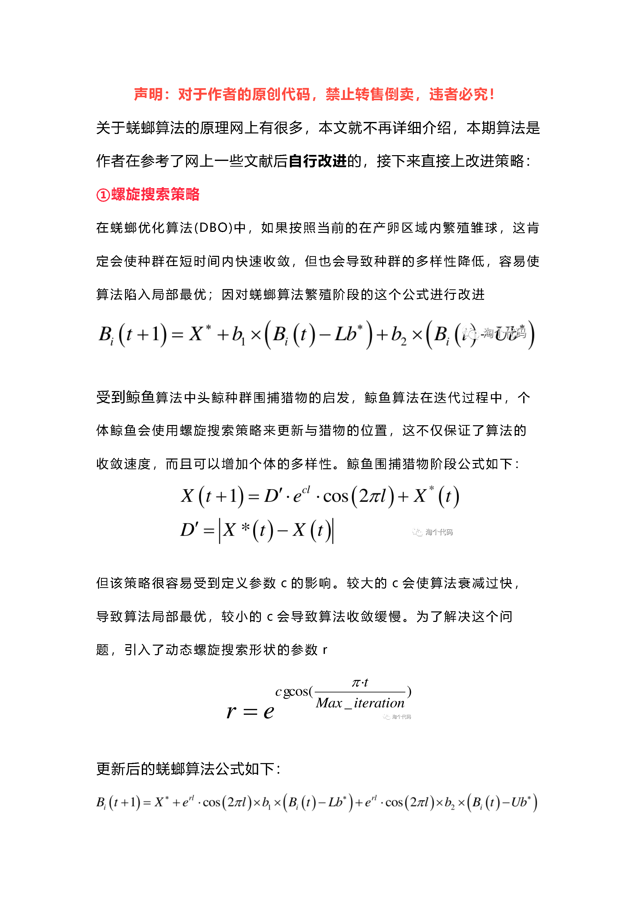
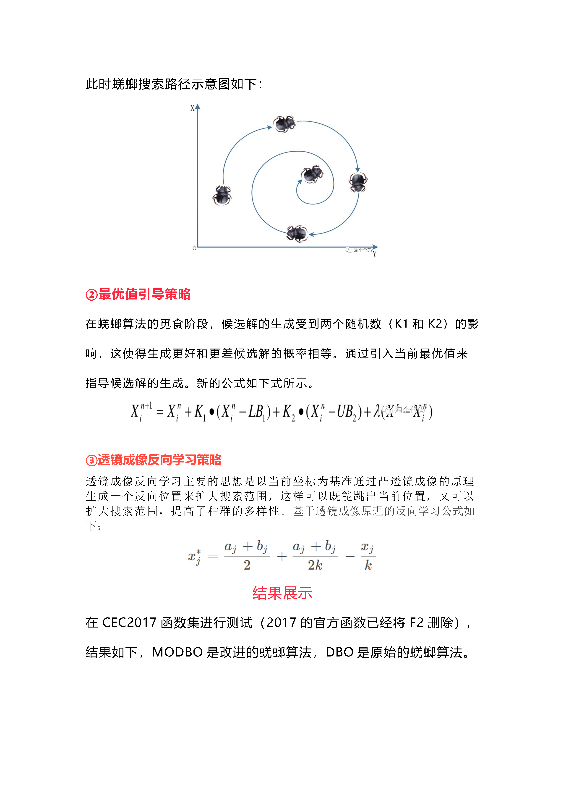
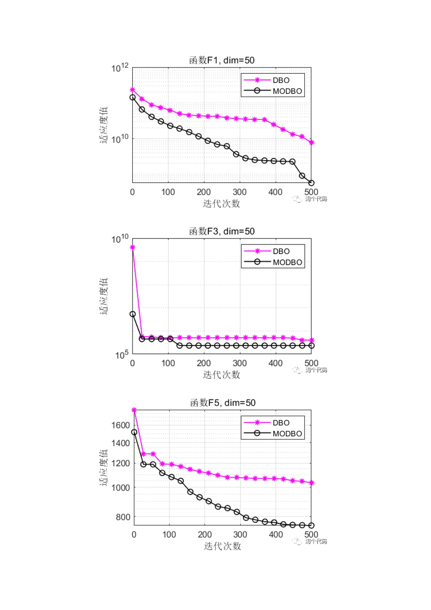
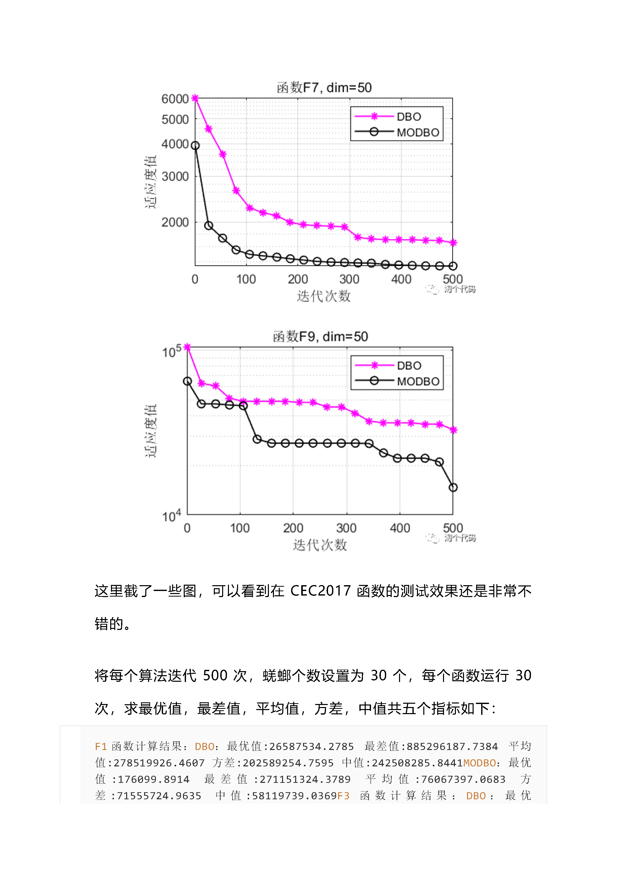
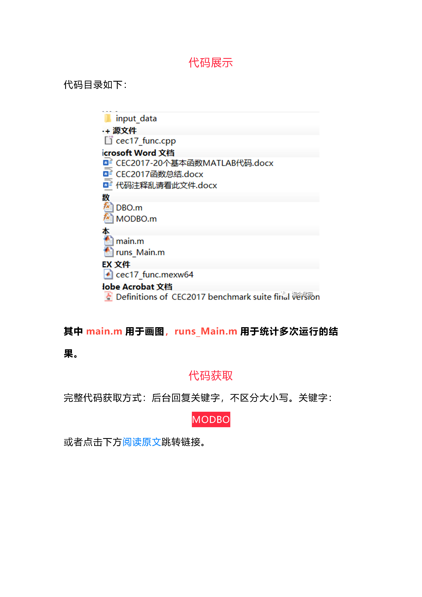

# Code is subject to review! Multi-strategy optimization for Dung Beetle - spiral search + optimal value guidance + reverse learning strategy

\n        \n  
\n        \n  
\n        \n  
\n        \n      F1Function calculation results: \nDBO: Optimal value:26587534.2785 Worst value:885296187.7384 Mean:278519926.4607 Variance:202589254.7595 Median:242508285.8441\nMODBO: Optimal value:176099.8914 Worst value:271151324.3789 Mean:76067397.0683 Variance:71555724.9635 Median:58119739.0369\nF3Function calculation results: \nDBO: Optimal value:68234.7729 Worst value:183691.5791 Mean:94827.9013 Variance:24515.5456 Median:85710.8004\nMODBO: Optimal value:43495.1783 Worst value:88562.5671 Mean:72813.6786 Variance:12252.9688 Median:73870.7348\nF4Function calculation results: \nDBO: Optimal value:527.017 Worst value:1040.0388 Mean:680.6191 Variance:117.5707 Median:652.1021\nMODBO: Optimal value:489.6904 Worst value:667.7609 Mean:578.4681 Variance:46.3321 Median:578.3268\nF5Function calculation results: \nDBO: Optimal value:634.5203 Worst value:852.6906 Mean:745.2637 Variance:56.4961 Median:746.7405\nMODBO: Optimal value:605.4213 Worst value:745.3838 Mean:670.8696 Variance:37.2748 Median:660.932\nF6Function calculation results: \nDBO: Optimal value:628.5647 Worst value:674.6842 Mean:651.2125 Variance:12.7984 Median:652.1216\nMODBO: Optimal value:615.4098 Worst value:645.7538 Mean:631.779 Variance:8.2401 Median:630.2963\nF7Function calculation results: \nDBO: Optimal value:881.1188 Worst value:1181.8156 Mean:1007.7016 Variance:81.108 Median:997.6261\nMODBO: Optimal value:845.7382 Worst value:1171.3257 Average:982.2269 Variance:74.989 Median:980.622\nF8Function calculation results: \nDBO: Optimal value:900.0545 Worst value:1115.7526 Mean:1015.9085 Variance:61.7286 Median:1021.6189\nMODBO: Optimal value:876.7522 Worst value:997.2142 Mean:935.4958 Variance:29.6456 Median:931.9413\nF9Function calculation results: \nDBO: Optimal value:3228.5143 Worst value:10660.7884 Mean:6865.7482 Variance:2069.9942 Median:6568.7554\nMODBO: Optimal value:2356.5046 Worst value:9446.0883 Mean:4412.454 Variance:1663.8413 Median:3953.9179\nF10Function calculation results: \nDBO: Optimal value:4148.651 Worst value:9271.6793 Mean:6483.3671 Variance:1227.6979 Median:6151.3225\nMODBO: Optimal value:4538.1623 Worst value:9031.1333 Mean:6957.6103 Variance:1492.6158 Median:7124.0549\nF11Function calculation results: \nDBO: Optimal value:1365.6167 Worst value:5717.5147 Mean:2127.2572 Variance:950.7368 Median:1774.9541\nMODBO: Optimal value:1249.599 Worst value:1584.6569 Mean:1372.9834 Variance:82.0467 Median:1353.0988\nF12Function calculation results: \nDBO: Optimal value:1636631.9163 Worst value:1000605880.0255 Mean:138651222.4276 Variance:260670382.031 Median:28103706.5293\nMODBO: Optimal value:741235.8851 Worst value:111300910.1722 Mean:17658055.4028 Variance:26724635.2059 Median:7560605.797\nF13Function calculation results: \nDBO: Optimal value:16922.7094 Worst value:64250525.1866 Mean:7551744.9668 Variance:15191181.2581 Median:863733.2001\nMODBO: Optimal value:12200.7897 Worst value:4332334.3432 Mean:844642.7411 Variance:1429735.1549 Median:134109.2547\nF14Function calculation results: \nDBO: Optimal value:3628.8755 Worst value:2211506.826 Mean:260147.4974 Variance:404203.3378 Median:133263.6727\nMODBO: Optimal value:3491.3099 Worst value:373667.4927 Mean:100189.6526 Variance:86068.427 Median:88233.6257\nF15Function calculation results: \nDBO: Optimal value:7695.8216 Worst value:28689714.0636 Mean:1020109.4677 Variance:5226163.1995 Median:57025.5877\nMODBO: Optimal value:2563.149 Worst value:259576.8021 Mean:51882.9929 Variance:60308.523 Median:30131.2416\nF16Function calculation results: \nDBO: Optimal value:2442.877 Worst value:4334.1086 Mean:3380.7791 Variance:437.699 Median:3427.9563\nMODBO: Optimal value:2564.1835 Worst value:4099.5328 Mean:3198.7369 Variance:386.1529 Median:3065.507\nF17Function calculation results: \nDBO: Optimal value:2059.4696 Worst value:3352.611 Average:2751.7228 Variance:322.2462 Median:2666.2677\nMODBO: Optimal value:2045.3209 Worst value:2946.2829 Mean:2520.9179 Variance:222.8829 Median:2547.0677\nF18Function calculation results: \nDBO: Optimal value:111995.098 Worst value:19260406.0013 Mean:4264684.775 Variance:5255649.3308 Median:1371475.4517\nMODBO: Optimal value:68714.5908 Worst value:10547312.9839 Average:1481340.6368 Variance:2029044.5584 Median:898592.8427\nF19Function calculation results: \nDBO: Optimal value:5683.5719 Worst value:127030449.7168 Mean:6205389.826 Variance:23073920.4903 Median:385245.8425\nMODBO: Optimal value:2395.6836 Worst value:2280405.74 Mean:343450.7177 Variance:601022.5335 Median:33246.0295\nF20Function calculation results: \nDBO: Optimal value:2258.4158 Worst value:3179.5373 Mean:2721.4361 Variance:243.5226 Median:2673.5387\nMODBO: Optimal value:2253.2546 Worst value:2935.108 Mean:2547.2821 Variance:163.9393 Median:2542.5695\nF21Function calculation results: \nDBO: Optimal value:2441.0167 Worst value:2681.4322 Average:2560.6592 Variance:57.929 Median:2543.5668\nMODBO: Optimal value:2329.3153 Worst value:2650.5783 Mean:2501.5493 Variance:65.9737 Median:2503.3205\nF22Function calculation results: \nDBO: Optimal value:2335.8041 Worst value:9005.9585 Mean:5147.7854 Variance:2563.4733 Median:6307.0029\nMODBO: Optimal value:2341.8913 Worst value:2482.0399 Mean:2379.9522 Variance:36.0528 Median:2365.957\nF23Function calculation results: \nDBO: Optimal value:2814.5573 Worst value:3110.1696 Mean:2971.2078 Variance:82.9108 Median:2974.881\nMODBO: Optimal value:2780.6881 Worst value:3069.9764 Mean:2914.6333 Variance:80.6054 Median:2885.1952\nF24Function calculation results: \nDBO: Optimal value:3037.3823 Worst value:3364.1985 Mean:3181.3893 Variance:87.9974 Median:3200.8671\nMODBO: Optimal value:2958.5651 Worst value:3242.334 Mean:3099.0717 Variance:86.5973 Median:3119.6384\nF25Function calculation results: \nDBO: Optimal value:2886.8655 Worst value:3132.0272 Mean:2976.574 Variance:59.3269 Median:2964.1102\nMODBO: Optimal value:2887.4245 Worst value:3017.7836 Mean:2931.109 Variance:34.0427 Median:2932.7968\nF26Function calculation results: \nDBO: Optimal value:5705.6121 Worst value:8479.805 Mean:6928.252 Variance:753.7997 Median:6805.2349\nMODBO: Optimal value:3125.2728 Worst value:7889.8513 Mean:6319.2604 Variance:1123.6276 Median:6616.5321\nF27Function calculation results: \nDBO: Optimal value:3222.1202 Worst value:3502.0427 Mean:3329.845 Variance:67.8683 Median:3327.1453\nMODBO: Optimal value:3222.4915 Worst value:3412.8692 Mean:3278.3387 Variance:38.4615 Median:3270.9476\nF28Function calculation results: \nDBO: Optimal value:3308.6423 Worst value:5999.3597 Mean:3805.3548 Variance:745.1675 Median:3481.9717\nMODBO: Optimal value:3213.5795 Worst value:3474.7211 Mean:3338.6909 Variance:54.5755 Median:3338.2342\nF29Function calculation results: \nDBO: Optimal value:3707.9156 Worst value:5630.6197 Mean:4508.4204 Variance:446.8148 Median:4528.4465\nMODBO: Optimal value:3762.919 Worst value:5242.045 Mean:4262.0952 Variance:340.2025 Median:4193.3854\nF30Function calculation results: \nDBO: Optimal value:23738.894 Worst value:18437793.6046 Average:3256963.3511 Variance:4381907.9519 Median:1187816.4769\nMODBO: Optimal value:11592.0291 Worst value:22223495.0405 Mean:2676568.7866 Variance:4774300.516 Median:894187.27\n>> \n\n        \n  

## Images

<!-- PAYMENT_BLOCK -->

## Get this dataset

- Payment link (Stripe): [Buy now](https://buy.stripe.com/3cs8yP7sY87d0vu9AB)
- Payment QR code: 

<!-- /PAYMENT_BLOCK -->
